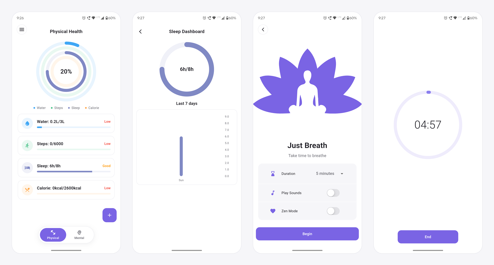
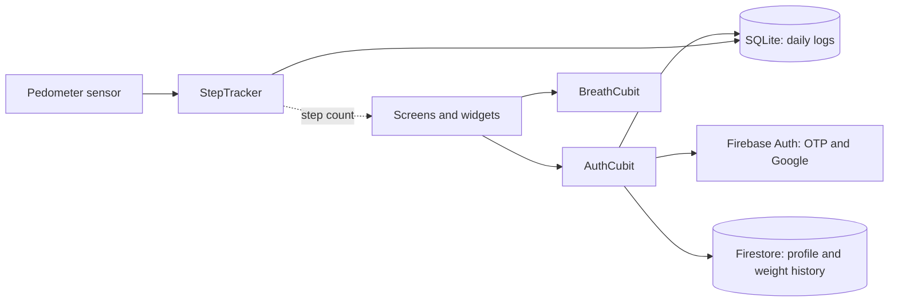

# Swastha

[](https://github.com/rks369/swastha_health_app/releases/tag/v2.0.1-4)


Swastha is a Flutter health and wellness app that brings physical and mental health tracking into one place, in a flat, minimal interface.

<p align="center">
  
</p>

## Features

**Physical health**
- Step counter using the phone's hardware step sensor
- Water, calorie and sleep tracking with daily dashboards and charts
- BMI calculator for yourself (age and gender come from your profile) or for someone else (pick gender and age)
- Weight and BMI history with a trend chart

**Mental health**
- Guided breathing exercises
- Meditation with a countdown timer
- Music player with relaxing tracks

**Account**
- Phone OTP and Google sign-in (Firebase Auth), with date of birth and gender captured at registration
- Profile and user details stored in Cloud Firestore
- Local history stored on device with SQLite

## Screenshots

<!--
Put images in docs/screenshots/ with the file names below.
Use light mode, one phone size for every shot, and realistic data.
-->

### Onboarding and sign-in

| Onboarding | Login | Complete Registration |
| :---: | :---: | :---: |
|  |  |  |

| Registration BMI | | |
| :---: | :---: | :---: |
|  | | |

### Physical health

| Physical Health | Add Menu | Quick Add |
| :---: | :---: | :---: |
|  |  |  |

| Metric Dashboard | Activity Permission | |
| :---: | :---: | :---: |
|  |  | |

### Mental health

| Mental Health | Just Breath | Meditation Timer |
| :---: | :---: | :---: |
|  |  |  |

| Zen Mode | Completion | Music Player |
| :---: | :---: | :---: |
|  |  |  |

| Resources | | |
| :---: | :---: | :---: |
|  | | |

### Menu and profile

| Side Menu | My Account | Weight History |
| :---: | :---: | :---: |
|  |  |  |

| BMI (Myself) | BMI (Someone else) | BMI Result |
| :---: | :---: | :---: |
|  |  |  |

| Privacy Policy | Terms & Conditions | |
| :---: | :---: | :---: |
|  |  | |

## Tech Stack

- Flutter / Dart
- State management: `flutter_bloc`
- Backend: Firebase (Auth, Firestore)
- Local storage: `sqflite`
- Steps: `pedometer`, `permission_handler`
- Charts: `fl_chart`; progress rings and bars are drawn with Flutter's own `CustomPaint`, so there is no commercial charting dependency
- UI: Material 3 with a single shared theme (`lib/utils/styles.dart`)
- Audio: `audioplayers`

## Project Structure

```
lib/
├── Bloc/        # AuthCubit, BreathCubit
├── database/    # SQLite helper
├── models/      # Data models, Metric enum
├── screens/     # Authentication, home, dashboards, side drawer
├── services/    # Step tracker, navigation helpers
├── utils/       # Styles, constants, BMI/age helpers
└── widgets/     # Reusable widgets (AppPage, rings, quick-add sheet)
```

## Architecture



- **SQLite for daily logs.** Water, sleep, calories and steps are written on the device, so logging works offline and charts load without a network call.
- **Firestore for the profile and weight history only.** These follow the account across devices and are the only health data that leaves the phone.
- **Cubits instead of full Blocs.** The state is simple (auth status, breathing settings), so plain methods are enough and there are no event classes to maintain.
- **`StepTracker` is a singleton service.** It owns the sensor subscription, keeps a per-day baseline in SQLite, and exposes the count as a `ValueNotifier` that the Physical tab listens to.

## Getting Started

### Prerequisites
- Flutter SDK (Dart `^3.13.7`)
- Android Studio or VS Code with the Flutter extension
- A Firebase project

### Setup

1. Clone the repository and install dependencies:
   ```
   flutter pub get
   ```
2. Add your Firebase config:
   - Android: place `google-services.json` in `android/app/`
   - Regenerate `lib/firebase_options.dart` with `flutterfire configure`
3. Run the app:
   ```
   flutter run
   ```

### Release build

Create `android/key.properties` with `keyAlias`, `keyPassword`, `storeFile` and `storePassword`, then:

```
flutter build apk --release
```

To skip x86 emulator code and keep one installable file, build for ARM only:

```
flutter build apk --release --target-platform android-arm,android-arm64
```

### Sharing with testers (Firebase App Distribution)

Upload the APK from `build/app/outputs/flutter-apk/app-release.apk`. An AAB is only accepted if the Firebase project is linked to Google Play. Increase the build number in `pubspec.yaml` (the part after `+`) before every upload.

## Permissions (Android)

`ACTIVITY_RECOGNITION` is requested at runtime so the step sensor can be read. Steps are counted from the sensor's total since boot, with a per-day baseline kept in SQLite, so steps taken while the app is closed are included the next time it opens.

## Privacy and data

| Data | Where it is stored |
| --- | --- |
| Name, phone number or Google email, gender, date of birth, height, weight, BMI, goals | Cloud Firestore (`users/{uid}`) |
| Weight and BMI history | Cloud Firestore (`users/{uid}/weights`) |
| Daily water, sleep, calories and steps | SQLite on your device only |
| BMI calculated for "Someone else" | Not stored anywhere |

Sign-in is handled by Firebase Authentication. The app has no analytics or advertising SDKs, and your data is not sold or shared with third parties. Firestore rules should restrict each user to their own documents (`request.auth.uid == userId`).

## Roadmap

- Health Connect integration for steps and sleep
- iOS build
- Widget and cubit tests

## Changelog

See [CHANGELOG.md](CHANGELOG.md).

## Tests

```
flutter test
```

## License

Swastha is licensed under the [PolyForm Noncommercial License 1.0.0](LICENSE). You may use, study, modify and share it for non-commercial purposes, including personal and hobby use, and use by charities, schools, public research, public health and government bodies. Any other use, including commercial use, needs a separate written licence from the author.
